# ALife Lab — ブラウザで動かす人工生命の実験室

<p align="center">
  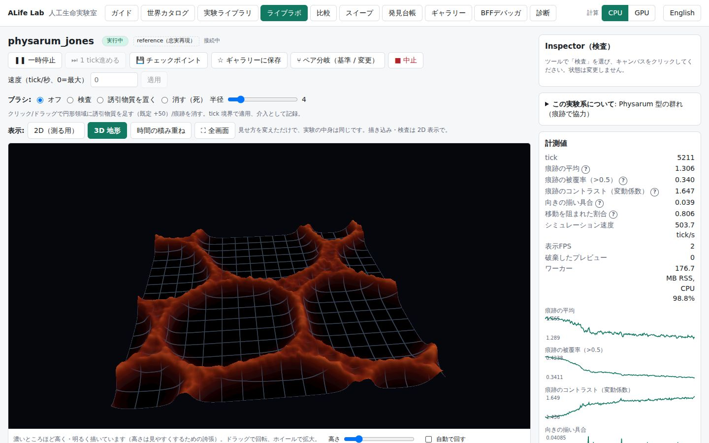
</p>

**ALife Lab** は、人工生命（Artificial Life, ALife）のさまざまな「世界」を、手元のパソコンで作って・動かして・手を加えて・記録して・比べるための実験室です。操作はすべてブラウザから行い、計算は自分のマシン（CPU、対応環境では GPU）で実行します。

- **多彩な人工生命を1か所で**：ライフゲーム、Lenia、Flow-Lenia、粘菌、自己複製プログラムのスープ（BFF）、ニューラルセルオートマトン、化学反応、プロトセル（原始細胞）、エージェント、群れ、身体を持つ生き物（MuJoCo）、そして**実データに基づくショウジョウバエの全脳・全中枢モデル、身体接続、258 万ニューロンの生態箱、ハエから始まる人工生命ワールド**まで 23 種類（128 プリセット）
- **見て分かる表現**：値をそのまま色で示す 2D 表示に加えて、3D 地形・時間の積み重ね・光る表示・3D 光る脳・CT スキャン形状の 3D ハエと脳の 2 画面同時表示・3D の生き物と歩容図（歩き方の記録）
- **科学的に確かめられる**：チェックポイント、正確なリプレイ（巻き戻し再生）、分岐、比較、スイープ（条件 × seed の統計比較）、発見台帳と証拠レベル（E0〜E4）、シャッフル配線などの比較用対照
- **探せる・進化させられる**：CMA-ES、MAP-Elites、新規性探索（Novelty Search）、IMGEP、ASAL（CLIP を使った探索）、そして外部スコアなしの自律進化ワールド
- **学べる**：やさしい日本語のガイドと用語集、各パラメータ・計測値の「?」ヘルプ

> 研究用の道具として作っています。「見た目が面白いこと」と「科学的に確かめられたこと」は明確に分けて扱います（[証拠レベルと正直な記録](#証拠レベルと正直な記録)）。

---

## 目次

- [何ができるか](#何ができるか)
- [実データで動かすハエの脳・体・群れ・人工生命](#実データで動かすハエの脳体群れ人工生命)
- [収録している人工生命の世界](#収録している人工生命の世界)
- [これまでに確かめたこと](#これまでに確かめたこと)
- [はじめかた](#はじめかた)
- [使い方の流れ](#使い方の流れ)
- [コマンドライン](#コマンドライン)
- [設計の考え方](#設計の考え方)
- [テスト](#テスト)
- [ディレクトリ構成とドキュメント](#ディレクトリ構成とドキュメント)
- [現状と今後](#現状と今後)
- [参考文献・ライセンス](#参考文献ライセンス)

---

## 何ができるか

### 1. 世界を作って、動かして、手を加える（ライブラボ）

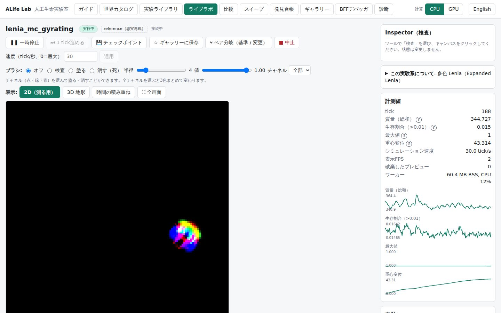

- **世界カタログ**からプリセットを選び、パラメータを確認して実験を作成します。作成前に、設定に誤りがないか、このマシンで動かせるかを自動でチェックします。
- **再生・一時停止・1ステップ（tick）ずつ進める・速度変更**ができ、実行中の様子は WebSocket でリアルタイムに画面へ届きます。
- **介入（ブラシ・刺激など）**：マスを描く・消す、粒を足す、生き物を押す、神経細胞を刺激・停止する、餌や捕食者の影を落とす、といった操作ができます。介入はすべて「いつ操作し、どの時点で反映されたか」が記録され、あとから正確に再現できます。
- **インスペクタ（中身を調べる）**：クリックした場所の値や、エージェントの感覚・行動確率、生き物の関節の角度、神経細胞の膜電位などを、実験の状態を変えずに確認できます。
- **チェックポイント（途中保存）**を残しておけば、サーバーを再起動しても続きから再開できます。

### 2. 見せ方を切り替える（2D・3D 地形・時間の積み重ね・光る表示・3D 光る脳）

GPU（WebGL2 / Three.js）を使った立体表示などにボタン1つで切り替えられます。あくまで見せ方が変わるだけで、実験の計算結果には一切影響しません（高さや光は見やすくするための演出です）。ブラシでの描き込みやインスペクタでの確認は、2D 表示で行います。

| 3D 地形：粘菌の輸送ネットワーク | 3D 地形：Flow-Lenia（3チャネル） |
|---|---|
| 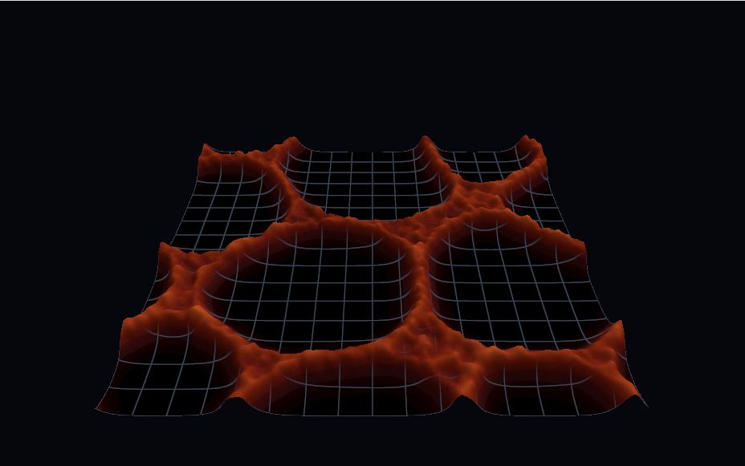 | 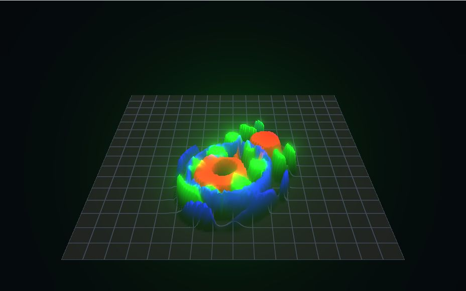 |
| **時間の積み重ね：Orbium（Lenia）** | **光る表示：Particle Life** |
|  |  |

- **3D 地形**：値の大きい場所を高く・明るく描きます。濃い領域が山のように盛り上がり、動くパターンが地形の上を移動していく様子が見えます。
- **時間の積み重ね**：時間ごとの画面を下から上へ積み重ねた半透明の立体です（上が現在、下が過去）。動くパターンは斜めの管、静止したパターンは柱、分裂は枝分かれとして見えます。
- **光る表示**：粒を光らせ、通った軌跡を光の尾として残します。
- **3D 光る脳**：コネクトーム実験では、実測された 3D 座標に全神経細胞（FlyWire v783 では 138,639 個）を並べ、発火した細胞をリアルタイムに光らせます。
- **全画面**表示にも対応しています。

### 3. 身体を持つ生き物（MuJoCo）

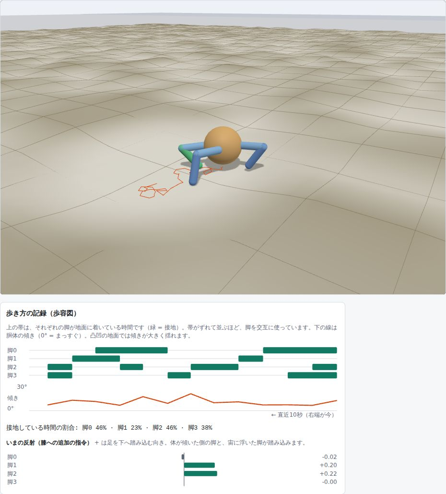

- 丸い胴体と脚でできた生き物が、重力・摩擦・関節のある物理世界（MuJoCo・CPU・倍精度計算）で、リズム生成器（CPG）に合わせて歩きます。
- seed ごとに変わる**凸凹の地面**や、体の傾き・足の接地に応じて膝を踏み込む**反射制御**を組み合わせられます。
- 3D 表示では、地面に着いている足が緑、胴体の通った軌跡が赤い線で表示されます。下の**歩容図**では、脚ごとの接地タイミング、胴体の傾き、反射の強さを確認できます。
- 「押す」ボタンで生き物に横や上から力を加えて、体勢を立て直せるか試せます（介入として記録されます）。

### 4. 自動探索と進化

| 探索の実行画面（MAP-Elites で生き物の体と歩き方を進化） | 系統図（どの候補からどの候補が生まれたか） |
|---|---|
| 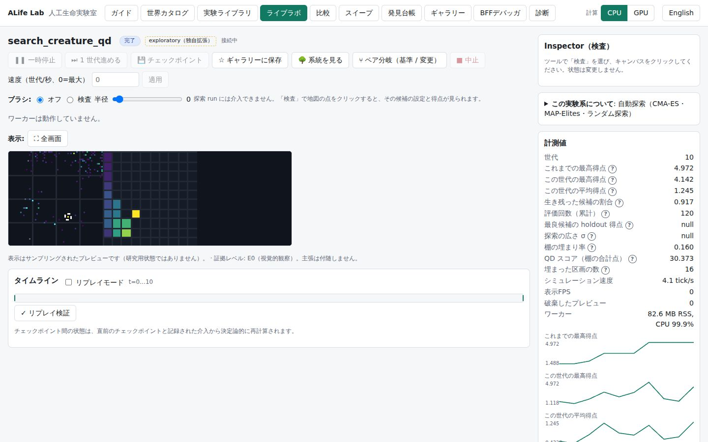 |  |

- **自動探索（search）**では、ほかの世界のパラメータ候補を次々と試し、あらかじめ決めた採点基準で評価します。世界の更新ルールそのものに報酬を混ぜることはしません。
- 対応手法：ランダム探索（比較用）、CMA-ES、MAP-Elites（特徴ごとに優秀な候補を集める手法）、新規性探索（Novelty Search）、IMGEP（自分で目標を立てて探す手法）。
- 採点基準の例：Lenia で「形を保ちながら動くパターン」を探す課題、CLIP で「指定した言葉に近い見た目」や「変化し続ける見た目」を探す課題（ASAL）、身体を持つ生き物で「倒れずにどれだけ遠くまで歩けるか」を競う課題。
- 探索の採点には使っていない別の乱数パターン（**holdout seed**）で最良候補を採点し直し、高得点がまぐれでないかを確かめます。
- **系統図**では、候補どうしの親子関係や選んだ候補の祖先をたどれます。気に入った候補は「普通の実験として開く」でライブラボへ持ち込めます。

### 5. 記録・再現・比較

- **リプレイ（正確な巻き戻し再生）**：過去の好きな tick に戻り、チェックポイントと介入の記録から当時の状態を厳密に計算し直します。スライダー操作も軽快で、再生速度も選べます。
- **リプレイ検証**：チェックポイント間を計算し直し、保存されていた状態とビット単位で一致するかを確かめます。
- **分岐（fork）とペア分岐**：好きな tick から実験を枝分かれさせ、「基準」と「1か所だけ変えた条件」の2つを並べて比べられます。
- **スイープ**：複数の条件と乱数パターン（seed）をまとめて実行し、効果量・ブートストラップ信頼区間・順列検定・Holm 補正で統計的に比較します。実行前に仮説を登録（事前登録）しておくこともできます。
- **発見台帳**：気になった候補を登録し、あらかじめ定めた検証試験（assay）によって「未確認・確認予定・試験済み・裏付けあり・裏付けなし・結論保留」を自動で判定します。判定結果はあとから手で書き換えられない仕組みです。
- **ギャラリー**：気に入った場面の画像と条件（spec）を保存しておき、あとから同じ実験を開き直せます。
- **バックアップ・検証・復元**（`alife backup`）。

### 6. 学べるガイド

| 世界カタログ | ガイド |
|---|---|
|  |  |

- 各世界について「何が起きるか」「見どころ」「試してみること」「比較用の実験」「言えること／まだ言えないこと」を、やさしい日本語で説明しています。
- パラメータ・計測値ごとの「?」ヘルプと用語集つき。画面は日本語が初期設定で、英語にも切り替えられます。

---

## 実データで動かすハエの脳・体・群れ・人工生命

公開されている実物のショウジョウバエの神経配線図（コネクトーム）を出発点に、**単体の脳 → 身体との接続 → 多匹の群れと生態箱 → ハエから始まる人工生命**までを一貫して体験・検証できます。すべての実験で CPU のみの小さな合成回路版も用意しているため、大容量データや GPU がない環境でも仕組みを試せます。

### 1. 光る 138,639 細胞の全脳と、身体を持つハエ（F0〜F10）

| 実 FlyWire v783 全脳（138,639 細胞・3D 光る脳） | 身体を持つハエ（左：CT 3D 物理ボディ / 右：実全脳） |
|---|---|
| 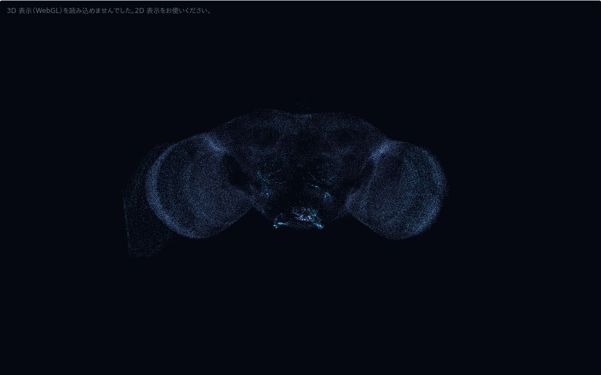 | 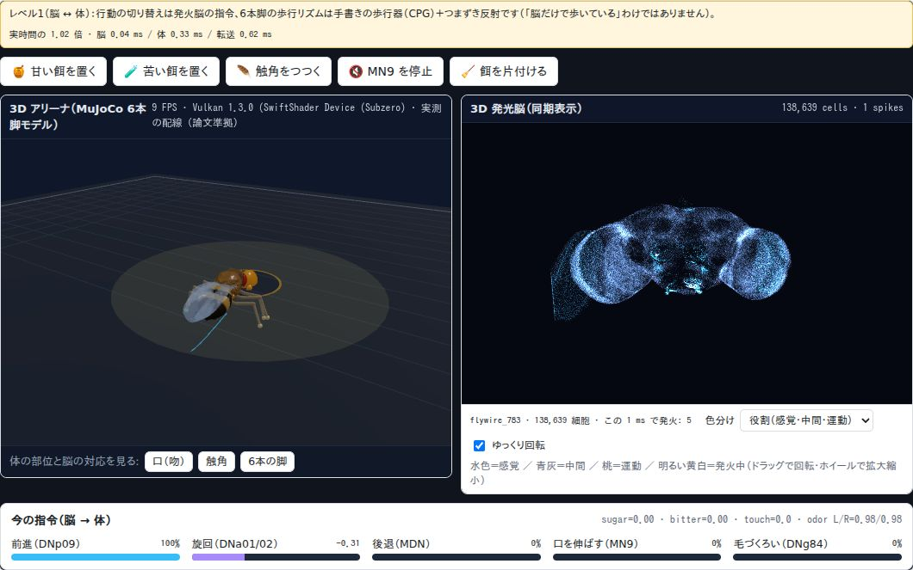 |

- **全脳の反応と学習（`connectome`）**：FlyWire v783（138,639 細胞・約 1,509 万本の結合）のスパイキング LIF モデルを CPU / GPU（CUDA グラフ）でビット一致実行します。画面から甘味・苦味・触角刺激を与えたり、任意の細胞種を停止して反応が崩れるか確かめたりできます。キノコ体（KC→MBON）でのパブロフ匂い条件づけや、実測の全脳カルシウム画像（Aimon 2023）・視覚回路（flyvis 45,669 細胞）との突き合わせにも対応しています。
- **脳と体のリアルタイム接続（`fly_embodied`）**：左の 3D アリーナで CT スキャン形状の 6 脚ハエ（MuJoCo）が匂いをたどって歩き、甘い餌で口（吻）を伸ばし、苦い餌で止め、触角をつつくと前脚で毛づくろいします。右ではその瞬間に光る 138,639 細胞の脳と、前進・旋回・摂食・毛づくろいの指令メーターが同期して動きます。

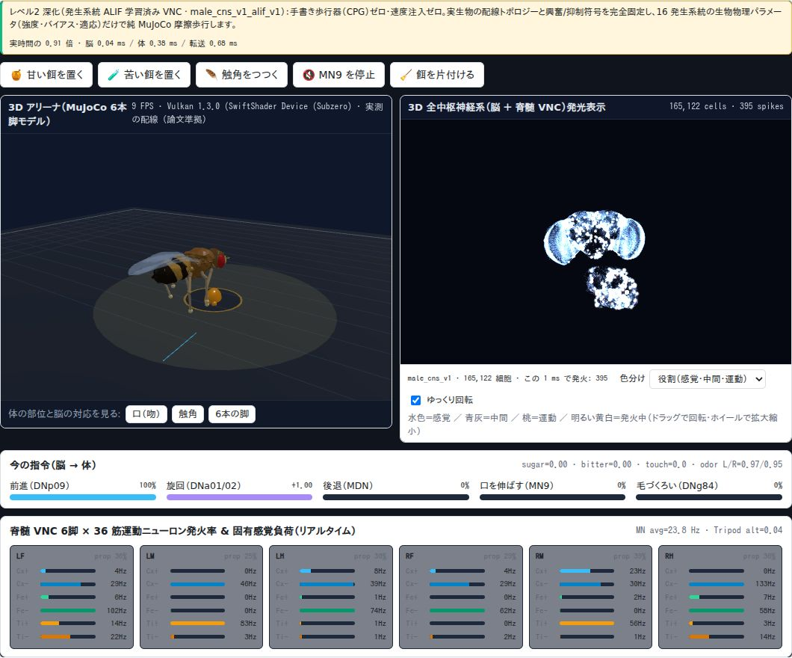

- **脊髄（VNC）の配線図だけで脚を動かす挑戦（レベル 2）**：メスの全中枢（**BANC v888**：156,808 細胞）とオスの全中枢（**MaleCNS v1.0**：165,122 細胞）をそのまま 6 本脚・18 関節の 36 運動ニューロン群へ直結し、手書きの歩行リズム器を外した状態で「配線図から歩き方が生まれるか」を調べられます。下のパネルに 6 本脚 × 6 筋の運動ニューロン発火率と接地感覚がリアルタイム表示されます。
- **たくさんの身体を GPU で一気に動かす（F9）**：MuJoCo Warp（`embodied-gpu`）と並列 LIF 脳を組み合わせ、32〜64 匹を同時に動かして回路の一斉停止スクリーニングや探索を行えます。

### 2. 258 万ニューロンが同時に暮らす雌雄生態箱（F11）

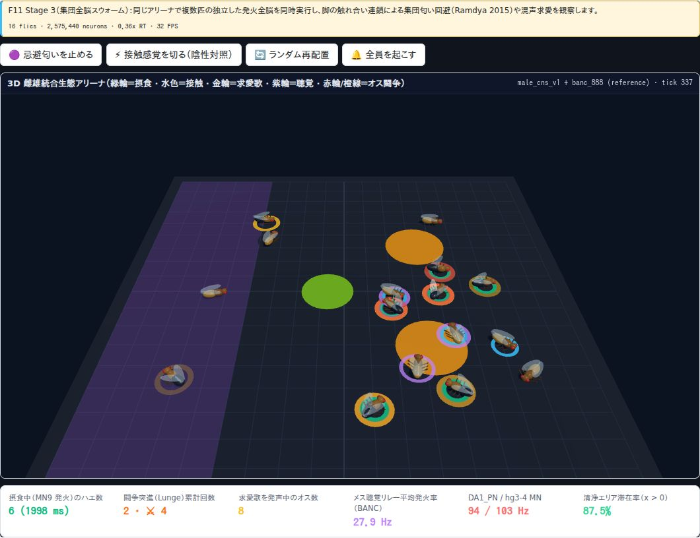

- **1 つの 3D アリーナで多匹の全脳・全中枢ハエを同時稼働（`fly_swarm`）**：
  - **集団での匂い忌避（Ramdya 2015）**：最大 24 匹の FlyWire 全脳（**計 333 万ニューロン**）を同時に走らせ、脚同士の接触が仲間に連鎖して嫌な匂いから集団で逃げ出す現象を再現します。
  - **オス同士の縄張り闘争**：12 匹の MaleCNS 全中枢（**計 198 万ニューロン**）が餌場を巡り、オスフェロモン（cVA）と視覚を手がかりに翅の威嚇・突進（ランジ）・敗者の撤退を繰り広げます。
  - **全部入り雌雄統合生態箱**：**MaleCNS オス 8 匹 ＋ BANC メス 8 匹（計 2,575,440 ニューロン）**が 1 つのアリーナで共存し、採餌（緑）・接触忌避（水色）・オスの求愛歌（金）・メスの聴覚応答（紫）・オス同士の闘争（赤/橙）がすべて同時に進行します。

### 3. ハエから始まる人工生命と「フル脳＋MuJoCo」1 クリック再生（F12 / F12d）

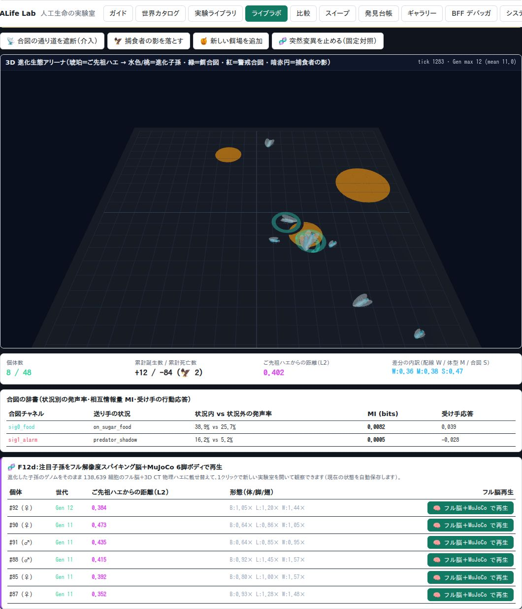

- **外からの採点（適応度スコア）ゼロの自律進化（`fly_world`）**：実 FlyWire 全脳を細胞種ごとに圧縮したご先祖脳（`138,639 → 17,641` ノード、基礎 4 反射の忠実度を検証済み）をベースに、個体ごとの小さな差分遺伝子（配線ゲイン・体形や脚/翅の長さ・2 系統の合図チャネル）が、採餌・頭上の捕食者の影からの逃避・自律的な繁殖だけで世代を超えて変化していきます。
- **ご先祖ハエからの距離と合図の辞書**：ご先祖に近いほど琥珀色、遺伝的に離れるほど水色〜赤紫へと体色が変化し、画面下に「どの状況で合図を出し、仲間の行動をどれだけ変えたか（相互情報量 MI bits・受け手応答）」がリアルタイムで集計されます。
- **注目子孫を 1 クリックでフル脳＋MuJoCo 再生（F12d）**：進化した子孫の一覧から「🧠 フル脳＋MuJoCo で再生」ボタンを押すと、その個体の遺伝子を **138,639 細胞のフル解像度スパイキング脳＋CT 3D 物理ハエ** へそのまま載せ替えて新しいラボで観察できます（CLI の `--replay-fine` で圧縮脳とフル脳の発火率比較も可能です）。
- *正直な位置づけ：* 進化で離れた子孫は、もはや生物のハエの模型ではなく **「ハエの配線から出発した人工生命」** として画面・記録の両方で明記しています。

---

## 収録している人工生命の世界

| | | |
|---|---|---|
| <br>**ライフゲーム**<br><sub>ランダムな初期状態から、ブロックや点滅する形が残る</sub> | 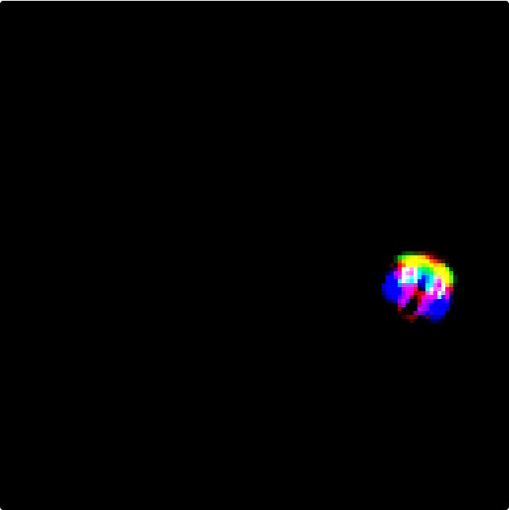<br>**多色 Lenia**<br><sub>3つの色の場が支え合って回転しながら進むパターン</sub> | 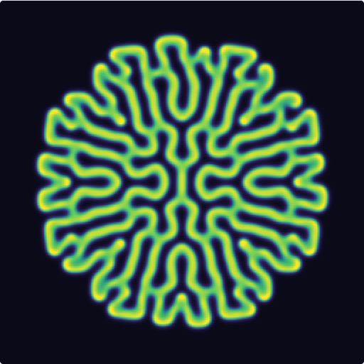<br>**Gray-Scott 反応拡散**<br><sub>2つの物質の反応と拡散でできるサンゴ状の模様</sub> |
| <br>**BFF 原始スープ**<br><sub>短いプログラムのスープ（命令として実行されるバイトを色付き、それ以外を灰色で表示）</sub> | <br>**ニューラルセルオートマトン**<br><sub>1つの種からハートの形に育つよう学習した細胞</sub> | <br>**プロトセル（原始細胞）**<br><sub>エサを取り込み、育ち、分裂する区画（白い縁が膜）</sub> |
| 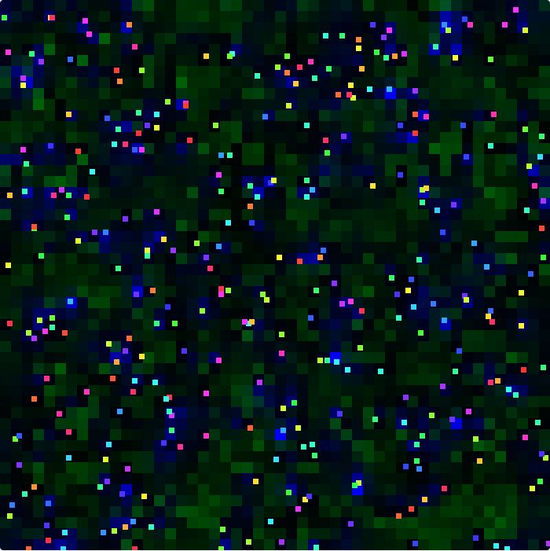<br>**エージェントの世界**<br><sub>エサ（緑）と仲間の合図（青）を手がかりに、食べ・学び・子孫を残す</sub> | 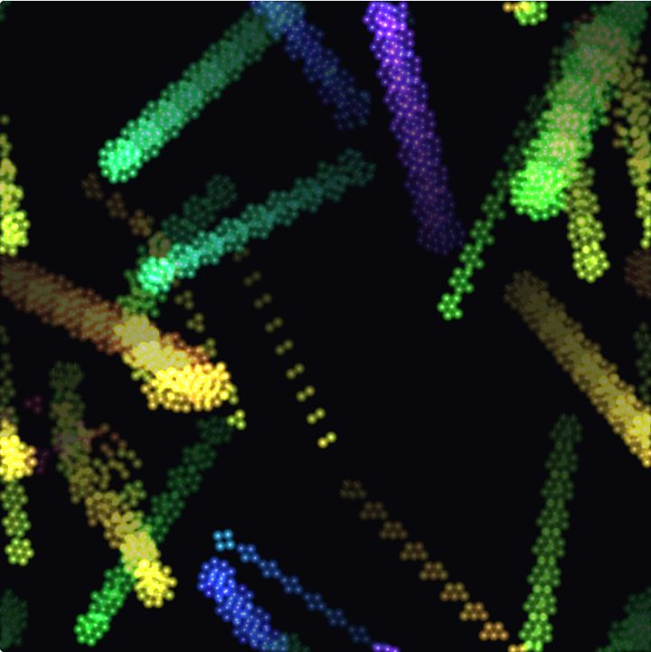<br>**ボイド（群れ・光る表示）**<br><sub>分離・整列・結合の3つの決まりだけで群れが流れる</sub> | <br>**多色 Lenia（3D 地形）**<br><sub>同じ世界を 3D 地形で表示したもの</sub> |

表の「再現性の確認状況」は、元の論文や公式コードと同じ結果になるかをどこまで検証したかを示しています。`reference`（論文準拠）は元の実装と比べて確かめたもの、`exploratory`（独自設定）は定まった参照実装がないか、このプロジェクト独自のモデルです。

| 種類 | 世界（substrate） | 元になった研究 | 再現性の確認状況 |
|---|---|---|---|
| セルオートマトン | ライフゲーム `conway` | Conway / Gardner 1970 | 基準となる単純な参照実装（CPU）と完全一致 |
| | Lenia `lenia` | Chan 2019、`Chakazul/Lenia`（MIT） | 元の `LeniaND.py`（CPU）と **1000 ステップでビット一致** |
| | 多色 Lenia `lenia_mc` | Chan 2020、ASAL `lenia_impl`（Apache-2.0） | 元の実装と 1 ステップ後 1e-15 以内 |
| | Flow-Lenia `flow_lenia` | Plantec ほか 2023 | 公式 JAX コード（float64）と 200 ステップで差 ≤ 1.1e-13、質量保存 |
| | ニューラル CA `nca_train` / `nca` | Mordvintsev ほか 2020（Distill） | 記事をもとに JAX で実装、同じ seed で学習結果を完全再現 |
| | Petri Dish NCA `pd_nca` | Sakana AI 2025 | 論文から独自実装（元コードはライセンス未明記のため不使用） |
| 反応拡散・化学 | Gray-Scott `gray_scott` | Pearson 1993 | 平衡状態や空間微分の性質を検証 |
| | 化学反応ネットワーク `reaction_network` | Gillespie 1977（直接法） | 保存則・ポアソン分布などの統計的性質を検証 |
| | プロトセル `protocell` | 独自モデル | 物質収支のずれが毎 tick ちょうど 0 |
| プログラム | BFF 原始スープ `bff` | Agüera y Arcas ほか 2024、CuBFF（Apache-2.0） | 公式 CuBFF の実行結果と**バイト単位で完全一致** |
| 粒子・エージェント | 粘菌 `physarum` | Jones 2010 | ネットワーク形成と比較用の実験を検証 |
| | ボイド `boids` | Reynolds 1987 | 独自設定（総当たり計算と空間分割による近傍探索が一致） |
| | Particle Life `particle_life` | Ventrella、Mohr（コミュニティモデル） | 独自設定 |
| | エージェントの世界 `agent_world` | 独自モデル（集団進化・寿命内学習） | 独自設定 |
| 身体 | 身体を持つ生き物 `creature` | Sims 1994 に着想、MuJoCo | 自由落下が理論値と一致、チェックポイントからビット単位で正確に再開 |
| 生き物の脳・身体・群れ | ハエ全脳モデル `connectome` | Shiu ほか 2024、FlyWire v783 | CPU と GPU（CUDA グラフ含む）が**ビット一致**、甘味→MN9・苦味抑制・毛づくろい・パブロフ学習を再現 |
| | 隠れ仕組み推定 `connectome_sysid` | 独自ベンチマーク（F5） | 観測ノイズ・部分観測下で隠れた時定数・符号反転・ギャップ結合の復元精度を検証 |
| | 配線トポロジ学習 `connectome_task` | ハエ配線 vs シャッフル配線（F6） | 同一統計のシャッフル対照と多 seed 比較 |
| | 身体を持つハエ `fly_embodied` | NeuroMechFly v2、BANC v888、MaleCNS v1.0 | 甘味摂食・苦味抑制・触角毛づくろい・MN9 停止・シャッフル崩壊（F8 レベル 1/2）を検証、チェックポイント完全一致 |
| | 全脳ハエの群れ・生態箱 `fly_swarm` | Ramdya ほか 2015、BANC、MaleCNS | 24 匹集団忌避 4/4・12 匹オス闘争 4/4・雌雄統合生態箱 5/5 合格（シャッフル・感覚遮断対照つき） |
| | ハエから始まる人工生命 `fly_world` | 独自モデル（F12 / F12d） | 圧縮ご先祖脳の 4/4 忠実度・3 基準合図検定・第 10 世代子孫のフル 138k 脳再生（4/4 定性一致）を検証 |
| 探索 | 自動探索 `search` | CMA-ES（Hansen）、MAP-Elites、ASAL（Kumar ほか 2024） | CMA-ES の挙動が参照実装（`purecma`）と一致 |

各世界の詳しい検証結果は [`docs/reference_fidelity/`](docs/reference_fidelity/) にまとめています。

---

## これまでに確かめたこと

事前に条件を決めて行った比較実験（スイープや対照実験）の結果です。仮説どおりにならなかった結果や限界も省かずに記録しています。

| 問い | 結果 |
|---|---|
| Lenia の「動いて形を保つパターン」探し：CMA-ES はランダム探索より良いか | **裏付けあり**（0.871 対 0.833、p = 0.0079） |
| MAP-Elites / 新規性探索 / IMGEP はランダム探索より多様な候補を集めるか | **裏付けあり**（区画埋まり率 0.153 / 0.130 / 0.150 対 0.089、Holm 補正 p ≤ 0.024） |
| 1色の Lenia で、CLIP は言葉ごとに違う見た目を選び分けるか | **裏付けなし**（どの言葉でも似た候補が選ばれた） |
| 多色 Lenia で、CLIP の採点による CMA-ES はランダム探索より良いか | **裏付けあり**（0.2948 対 0.2869、p = 0.024） |
| 生き物：体と歩き方を一緒に進化させると、ランダム探索より遠くまで歩くか | **裏付けあり**（20.4 m 対 11.1 m、p = 0.0079） |
| 生き物：凸凹の地面では、反射も一緒に進化させると遠くまで歩くか | **裏付けなし**（25.5 m 対 22.0 m、p = 0.19）。ただし進化した反射を外すと 5 体とも悪化 |
| BFF：小さなスープ（4096 プログラム）でも自己複製プログラムは現れるか | 2 seed・5000 エポックでは現れず（この規模では確認できず） |
| 実 FlyWire 全脳でパブロフ匂い条件づけは成立するか（F4） | **裏付けあり**（対提示 `+6.9 Hz` 対 非対提示 `+0.2 Hz`・DAN なし `0.0 Hz`、5 seed 再現） |
| 実測の全脳カルシウム画像（Aimon 2023）の未計測領域を FlyWire 配線で当てられるか（F7） | **5/5 seed で実配線が勝利**（`R² = +0.542` 対 シャッフル `+0.499`）。一方 DoOR 2.0 末梢匂い応答では差なし（`p = 0.944`、**陰性結果**） |
| 全中枢（BANC / MaleCNS）の脊髄配線だけで手書き歩行器なしに歩けるか（F8 レベル 2） | 16 系統 ALIF 学習で純摩擦前進（`+1.41 cm / +0.90 cm`）と隔離 VNC での反位相 3 脚振動（`-0.435 / -0.936`）を創発。ただしラチェット封印下の全中枢持続前進は未達（**E3 陰性結果**も記録） |
| 24 匹の FlyWire 全脳で Ramdya (2015) の集団匂い忌避は再現するか（F11） | **裏付けあり**（1 匹 `12.5%` → 24 匹 `45.8%`；脚接触遮断で `4.2%`・シャッフル配線で `12.5%` に崩壊） |
| 雌雄全中枢（MaleCNS ♂ ＋ BANC ♀）で求愛歌・闘争・採餌が同時成立するか（F11） | **裏付けあり**（オスの歌がメスの聴覚神経を `41〜81 Hz` 駆動し、シャッフルで `0.0〜0.45 Hz` に崩壊；オス闘争も cVA 遮断・シャッフルで `0` 回に崩壊） |
| 外発スコアなしの `fly_world` で意味のある合図が生まれ、フル脳再生でも一致するか（F12 / F12d） | **意味のある合図と 4/4 フル脳一致を確認**（`MI = 0.270 bits`＝シャッフルの 539 倍、Gen 10 子孫を 138k フル脳で再生し 4/4 定性一致）。ただし短期 1,200 tick の因果フォークではまだ正の採餌利得に達せず（**正直な陰性結果**として記録） |

詳しくは [`docs/reference_fidelity/search.md`](docs/reference_fidelity/search.md)、[`docs/reference_fidelity/creature.md`](docs/reference_fidelity/creature.md)、[`docs/reference_fidelity/connectome_fly.md`](docs/reference_fidelity/connectome_fly.md) を参照してください。

---

## はじめかた

### 必要なもの

- Linux（WSL2 を含む）、Python 3.12〜3.13 と [uv](https://docs.astral.sh/uv/)、Node.js（Web 画面のビルド用）
- GPU は必須ではありません（対応 GPU があればコネクトーム全脳や Lenia・BFF などが高速に動きます）。CPU だけですべての基本機能と合成回路版のコネクトーム実験が動作します。

### インストールと起動

```bash
uv sync                                                        # 基本機能
npm --prefix frontend ci && npm --prefix frontend run build    # Web 画面のビルド（初回・更新時）
uv run alife doctor                                            # 環境の確認（CPU/GPU、依存関係、設定）
uv run alife serve --host 127.0.0.1 --port 8000                # http://127.0.0.1:8000/ をブラウザで開く
```

### 追加の機能（必要なものだけ）

| extra | 中身 | 使う場面 |
|---|---|---|
| `fast` | Numba | BFF の CPU 計算を高速化（結果はビット一致） |
| `gpu` | CuPy（CUDA 13） | BFF・Lenia・Flow-Lenia・コネクトーム全脳／生態箱／進化ワールドを GPU で高速実行（`local_gpu` プロファイル選択時） |
| `nca` / `nca-gpu` | JAX（CPU / CUDA 13） | ニューラル CA の学習と実行、Petri Dish NCA |
| `asal` | PyTorch、OpenCLIP | CLIP を使った探索（ASAL）、コネクトームの隠れ仕組み推定・実脳データ適合（F5〜F7） |
| `embodied` | MuJoCo | 身体を持つ生き物（`creature`）、身体を持つハエ（`fly_embodied`） |
| `embodied-gpu` | MuJoCo Warp | GPU での 32〜64 匹並列物理＋全脳バッチ実行（F9） |
| `vision` | flyvis | ショウジョウバエ視覚系 45,669 細胞モデル（F10） |

```bash
uv sync --extra embodied --extra gpu     # 例：身体を持つハエ・全脳モデルを GPU で動かす場合
```

サーバーはローカル専用です（`127.0.0.1`）。画面から API を呼ぶためのセッション・トークンは、起動のたびに自動で発行されます。

---

## 使い方の流れ

1. **ガイド**で、気になる世界の解説を読む
2. **世界カタログ**でプリセットを選ぶ（128 種類）。必要なら設定を調整し、検証結果を確認して「実験を作成」
3. **ライブラボ**で観察する。表示を切り替え、ブラシや刺激・餌・捕食者の影で手を加え、インスペクタで中身を確認し、チェックポイントを保存する
4. `fly_world` で面白い子孫が育ったら、画面下の **「フル脳＋MuJoCo で再生」** ボタンで 138,639 細胞のフル脳＋3D 物理ハエとして別ラボでじっくり観察する
5. 気になった場面は**リプレイ**で巻き戻して見直し、その時点から**分岐**して条件を変えながら**比較**する
6. 結果が偶然かどうかは**スイープ**（条件 × seed）で統計的に確かめる
7. 見つけた候補を**発見台帳**に登録し、決められた検証試験で判定する。気に入った場面は**ギャラリー**へ保存する
8. **自動探索**で新しい振る舞いを探し、**系統図**で変化の道筋をたどる

---

## コマンドライン

Web 画面と同じ検証・保存の仕組みを、コマンドラインからも利用できます。

```bash
uv run alife substrates list                                   # 世界の一覧（23 種類）
uv run alife presets list                                      # プリセットの一覧（128 種類）
uv run alife targets list                                      # 実行先の一覧と性能の確認
uv run alife run configs/scenarios/conway_reference.yaml       # サーバーなしで最後まで実行
uv run alife runs list                                         # 保存された実験の一覧
uv run alife runs verify <run_id>                              # 保存データのハッシュ（改ざんの有無）を検証
uv run alife runs replay-verify <run_id>                       # リプレイ検証
uv run alife sweep configs/sweeps/search_cma_vs_random.yaml    # スイープと統計比較
uv run alife compare <run_a> <run_b>                           # 共通のチェックポイントで状態の差を比較
uv run alife backup create|verify|restore                      # バックアップの作成・検証・復元

# コネクトーム・身体・群れ・人工生命の検証コマンド（合成回路なら CPU のみで即実行可能）
uv run alife connectome list                                   # 登録済みデータセットの確認
uv run alife connectome embody synthetic_fly_embodied          # 身体を持つハエの反射・対照検証（F8）
uv run alife connectome swarm synthetic_fly_embodied --mode ecosystem  # 雌雄統合生態箱の検証（F11）
uv run alife connectome evolve synthetic_fly_embodied --replay-fine    # 自律進化＋フル脳再生検証（F12/F12d）
```

---

## 設計の考え方

- **科学的条件と実行環境を分ける**：`ExperimentSpec`（ルール、seed、数値の扱い、評価方法、停止条件）と `ExecutionProfile`（どの計算機・どれだけの計算資源で動かすか）は別々のハッシュ値として記録します。GPU メモリに収めるために、世界の大きさや個体数、計算精度を黙って変えることはしません。
- **世界のルール・探索・計測・画面表示を分ける**：世界のルールに外部報酬を足さない、探索は外から候補を試すだけ、計測は状態を変えない、という境界を守ります。画面プレビューは負荷に応じて間引くことがありますが、科学的な状態・介入履歴・チェックポイント・計測値は一切欠落させません。
- **再現できる記録**：すべての実験に、ソースコードのコミット、実験条件のハッシュ、乱数の方針、使用バックエンド、保存ファイルのハッシュ、チェックポイントの互換情報を記録します。
- **プロセスの分離**：API サーバー（FastAPI）と、計算を担うワーカー、リプレイ用プロセスは別プロセスで動かします。実験データベース（SQLite）への書き込みはコントローラーだけに限定しています。
- **安全性**：ローカル専用、トークンと Host/Origin の確認、ブラウザから任意のコードを実行させない設計、安全性の確認できない pickle ファイルの拒否、チェックポイント・データセット読み込み時の SHA-256 検証を徹底しています。

### 証拠レベルと正直な記録

| レベル | 意味 |
|---|---|
| E0 | 見た目の観察（画面や動画で面白い現象が見えた段階） |
| E1 | 決めた指標で差や特徴が数値として測れた段階 |
| E2 | 別の seed や初期条件でも再現する段階 |
| E3 | 比較用の実験（要素を外す・変える介入）により、仕組みの原因が絞り込まれた段階 |
| E4 | 別の実装や外部の既知例でも成り立つと確かめられた段階 |

E0・E1 の段階で「生命を発見した」「自己複製を証明した」とは書きません。仮説が外れた結果や、うまくいかなかった候補もそのまま記録します。

---

## テスト

```bash
uv run pytest -q                       # 単体・参照実装比較・性質・結合・API テスト
npm --prefix frontend test             # 画面の単体テスト
ALIFE_E2E_CHROMIUM=<chromium のパス> npm --prefix frontend run e2e   # ブラウザからの一連の操作テスト（サーバー再起動を含む）
uv run python scripts/check_staged.py  # コミット前の秘密情報・大容量ファイルの検査
```

- 世界ごとに CPU の参照実装との比較テストと、「意図した現象が起きないことを確認する比較用テスト」を用意しています。
- README の画像は `ALIFE_README_SHOTS=1` を付けて `frontend/e2e/readme_shots.spec.ts` を実行すると撮り直せます。

---

## ディレクトリ構成とドキュメント

```
src/alife_lab/
  api/          FastAPI（REST + WebSocket）、ローカル実行向けの安全対策
  service/      コントローラー（実験の状態管理、リプレイ、スイープ、発見台帳、ギャラリー）
  execution/    ワーカー、LocalExecutor / FakeExecutor、正確なリプレイ
  substrates/   各世界のアダプター（conway, lenia, flow_lenia, bff, creature, connectome, fly_embodied, fly_swarm, fly_world など）
  connectome/   実生物コネクトームのデータ読み込み・LIF/ALIF 計算（CPU / CUDA）・身体接続・群れ・生態箱・進化エンジン
  evolution/    探索アルゴリズム、評価関数、ASAL
  artifacts/    ArtifactStore（チェックポイント、ハッシュ検証、破損を防ぐ安全な保存）
  storage/      SQLite メタデータ、Parquet 計測ログ
frontend/       React + TypeScript の Web 画面（Three.js は 3D 表示のときだけ読み込み）
configs/        シナリオ、プリセット（128 種）、スイープ、実行プロファイル、学習済み VNC プロファイル
tests/          unit / reference / property / integration / api / end_to_end
docs/           仕様、ロードマップ、設計判断（ADR）、各世界の検証記録
```

| 文書 | 内容 |
|---|---|
| [`docs/ALIFE_LAB_SPEC.md`](docs/ALIFE_LAB_SPEC.md) | 全体の仕様（科学・計算・画面・API・ロードマップ） |
| [`docs/plans/connectome_plan.md`](docs/plans/connectome_plan.md) | コネクトーム〜ハエの体・群れ・人工生命（F0〜F12d・S1〜S7）の全体計画と進捗 |
| [`docs/architecture.md`](docs/architecture.md) | システム構成 |
| [`docs/api.md`](docs/api.md) | API 仕様 |
| [`docs/decisions/`](docs/decisions/) | 設計判断の記録（ADR 0001〜0049） |
| [`docs/reference_fidelity/`](docs/reference_fidelity/) | 各世界の検証記録・モデルカード |
| [`docs/substrates/`](docs/substrates/) | 各世界の状態・介入・指標・表示形式の取り決め |
| [`docs/hardware_benchmarks.md`](docs/hardware_benchmarks.md) | ハードウェア実測ベンチマーク |
| [`docs/GIT_AND_ARTIFACT_POLICY.md`](docs/GIT_AND_ARTIFACT_POLICY.md) | Git と実験データの保管ルール |
| [`AGENTS.md`](AGENTS.md) | 開発エージェント向けの開発契約 |

---

## 現状と今後

| 区分 | 内容 |
|---|---|
| 実装済み | 23 の世界（128 プリセット）、ライブラボ、各種 3D 表示（3D 地形・時間の積み重ね・光る表示・3D 光る脳・CT 3D ハエ 2 画面・多匹生態アリーナ・進化ワールド）、ショウジョウバエ全脳・全中枢ロードマップ F0〜F12d（学習・実データ適合・身体接続・Warp 並列・視覚・雌雄比較・258 万ニューロン生態箱・自律進化とフル脳 1 クリック再生）、リプレイ・分岐・比較・スイープ、発見台帳、ギャラリー、系統図、自動探索と進化（ASAL 含む）、CLI、バックアップ |
| 一部のみ | CLI の一部（`runs reproduce / report / export` は未実装） |
| 今後の候補 | 他種コネクトーム展開（線虫 *C. elegans*・ハエ幼虫・ゼブラフィッシュ・マウス視覚野など S1〜S7）、長時間進化ランでの合図の因果利得検証（E3）、リモート計算機・複数 GPU・計算クラスタ対応（あとから追加できる設計済み・未実装） |

---

## 参考文献・ライセンス

このプロジェクトのライセンスは未定です（現時点では非公開扱い）。

参考にした研究・実装（コードを移植・比較したものはライセンスを確認し、出典を各検証記録に記載しています）：

- J. Conway / M. Gardner, *Scientific American* (1970) — ライフゲーム
- B. W.-C. Chan, "Lenia — Biology of Artificial Life", *Complex Systems* 28(3), 2019；"Lenia and Expanded Universe", 2020；[`Chakazul/Lenia`](https://github.com/Chakazul/Lenia)（MIT）
- E. Plantec ほか, "Flow-Lenia", ALIFE 2023
- B. Agüera y Arcas ほか, "Computational Life", arXiv:2406.19108 (2024)；[`paradigms-of-intelligence/cubff`](https://github.com/paradigms-of-intelligence/cubff)（Apache-2.0）
- A. Mordvintsev ほか, "Growing Neural Cellular Automata", *Distill* (2020)
- Sakana AI, "Petri Dish Neural Cellular Automata" (2025)
- A. Kumar ほか, "Automating the Search for Artificial Life with Foundation Models" (2024)；[`SakanaAI/asal`](https://github.com/SakanaAI/asal)（Apache-2.0）
- J. E. Pearson, "Complex Patterns in a Simple System", *Science* 261 (1993)
- D. T. Gillespie, *J. Phys. Chem.* 81(25) (1977)
- J. Jones, "Characteristics of pattern formation and evolution in approximations of Physarum transport networks", *Artificial Life* 16(2) (2010)
- C. W. Reynolds, "Flocks, Herds, and Schools", SIGGRAPH (1987)
- K. Sims, "Evolving Virtual Creatures", SIGGRAPH (1994)
- P. K. Shiu ほか, "A *Drosophila* computational brain model reveals sensorimotor processing", *Nature* 634, 210–219 (2024)；S. Dorkenwald ほか, *Nature* (2024) — FlyWire v783
- A. S. Bates ほか（Lee Lab）— BANC v888（CC-BY 4.0）；HHMI Janelia / Google Research — MaleCNS v1.0（CC-BY 4.0）
- S. Aimon ほか, *eLife* 85202 (2023)；D. Münch & C. G. Galizia, DoOR 2.0, *Sci. Rep.* (2016)
- J. K. Lappalainen ほか, *Nature* (2024) — [`TuragaLab/flyvis`](https://github.com/TuragaLab/flyvis)；S. Wang-Chen ほか, *Nature Methods* (2024) — NeuroMechFly v2（Apache-2.0 形状データのみ利用）
- P. Ramdya ほか, "Mechanosensory interactions drive collective behaviour in *Drosophila*", *Nature* (2015)
- N. Hansen, CMA-ES；J.-B. Mouret & J. Clune, MAP-Elites (2015)
- [MuJoCo](https://github.com/google-deepmind/mujoco) / [MuJoCo Warp](https://github.com/google-deepmind/mujoco_warp)（Apache-2.0）、[Three.js](https://threejs.org/)（MIT）、[OpenCLIP](https://github.com/mlfoundations/open_clip)（MIT）
