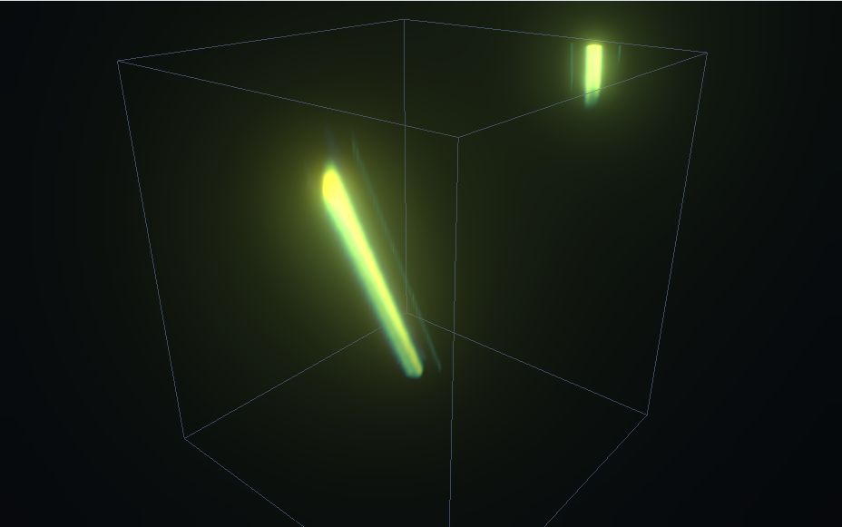
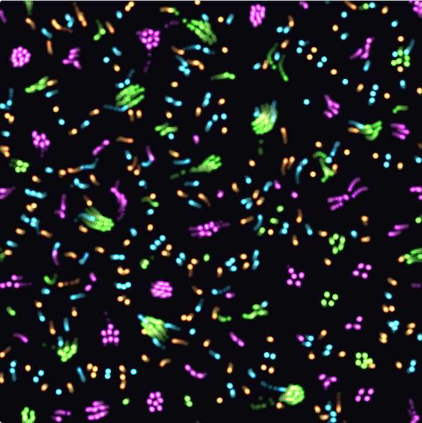
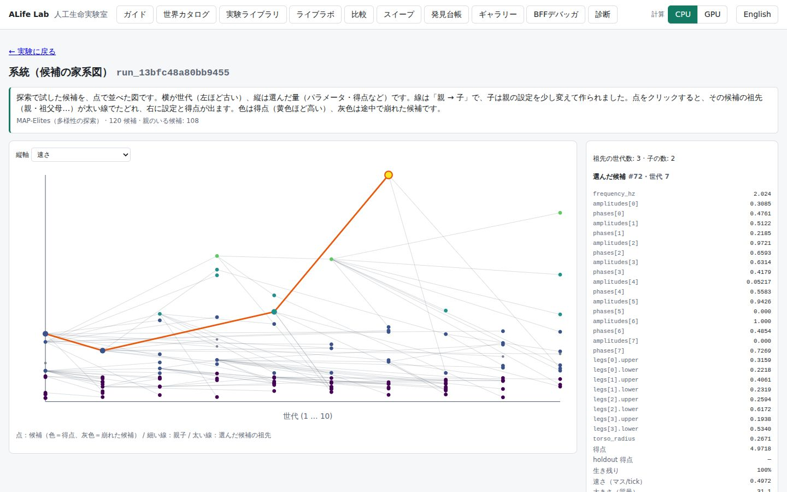
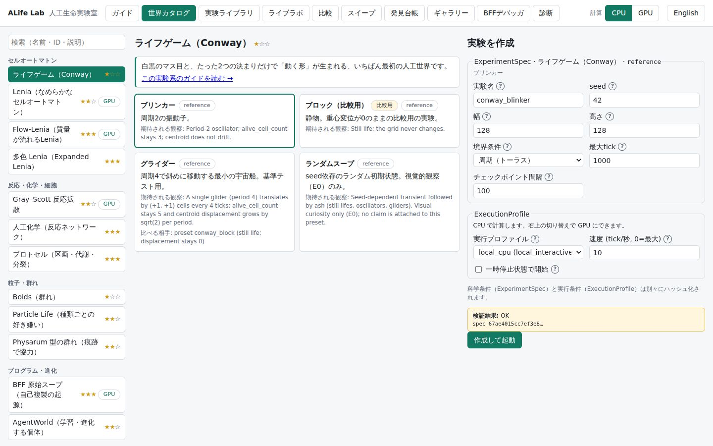
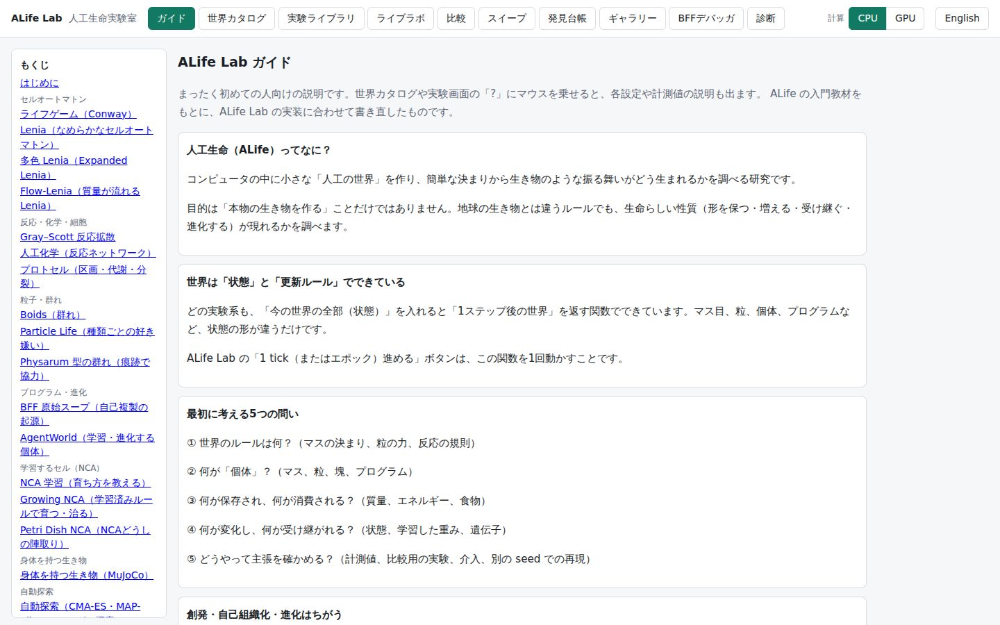
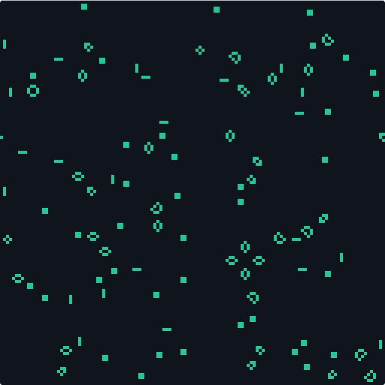
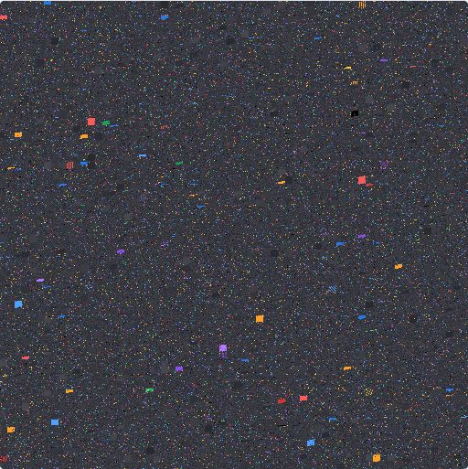
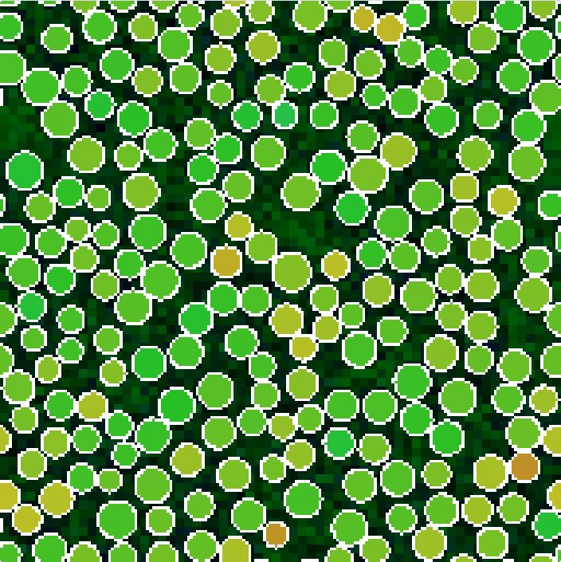
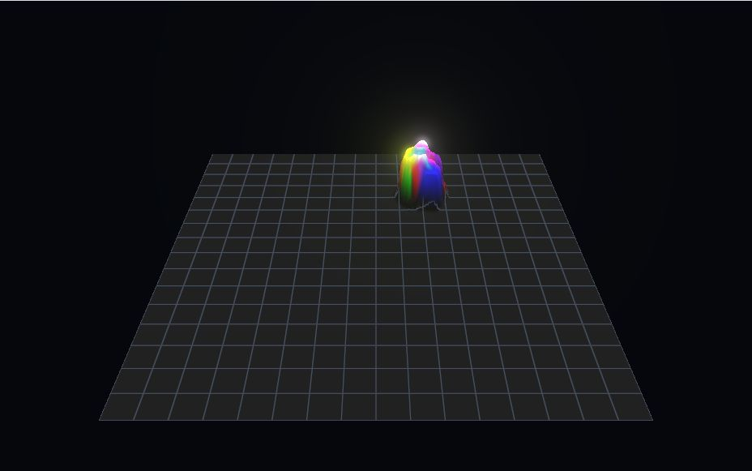

# ALife Lab — ブラウザで動かす人工生命の実験室

<p align="center">
  
</p>

**ALife Lab** は、人工生命（Artificial Life, ALife）のさまざまな「世界」を、手元のパソコンで作って・動かして・手を加えて・記録して・比べるための実験室です。操作はすべてブラウザから行い、計算は自分のマシン（CPU、あれば GPU）で行います。

- **いろいろな人工生命を1か所で**：ライフゲーム、Lenia、Flow-Lenia、粘菌、自己複製プログラムのスープ（BFF）、ニューラルセルオートマトン、化学反応、原始細胞、エージェント、群れ、身体を持つ生き物（MuJoCo）など17種類
- **見て分かる**：2D の「測る用」表示に加えて、3D 地形・時間の積み重ね・光る表示・3D の生き物と歩き方の記録
- **確かめられる**：チェックポイント、決定論的リプレイ、分岐、比較、スイープ（条件 × seed の統計）、発見台帳と証拠レベル（E0〜E4）
- **探せる・進化させられる**：CMA-ES、MAP-Elites、新しさ探索、IMGEP、ASAL（CLIP を使った探索）
- **学べる**：やさしい日本語のガイドと用語集、各パラメータの「?」ヘルプ

> 研究用の道具として作っています。見た目が面白いことと、科学的に確かめられたことは区別して扱います（[証拠レベル](#証拠レベルと正直な記録)）。

---

## 目次

- [何ができるか](#何ができるか)
- [収録している人工生命の世界](#収録している人工生命の世界)
- [これまでに確かめたこと](#これまでに確かめたこと)
- [はじめかた](#はじめかた)
- [使い方の流れ](#使い方の流れ)
- [コマンドライン](#コマンドライン)
- [設計の考え方](#設計の考え方)
- [テスト](#テスト)
- [ディレクトリ構成とドキュメント](#ディレクトリ構成とドキュメント)
- [現状と今後](#現状と今後)
- [参考文献・ライセンス](#参考文献ライセンス)

---

## 何ができるか

### 1. 世界を作って、動かして、手を加える（ライブラボ）


- **世界カタログ**から実験を選び、パラメータを確認して作成します。作成前に、設定が正しいか・このマシンで動かせるかを検証します。
- **再生・一時停止・1 tick 進める・速度変更**。実行中の世界は WebSocket で画面に送られます。
- **介入（ブラシ）**：セルを描く・消す、粒子を足す、生き物を押す、など。介入はすべて「いつ頼まれて、いつ適用されたか」が記録され、あとで正確に再現できます。
- **検査（Inspector）**：クリックした場所の値や、エージェントの感覚・行動の確率、生き物の関節角度などを、実験を変えずに読み取ります。
- **チェックポイント**を保存し、サーバーを再起動しても続きから再開できます。

### 2. 見せ方を切り替える（2D・3D 地形・時間の積み重ね・光る表示）

GPU（WebGL2 / three.js）で描く見せ方を、ボタン1つで切り替えられます。どれも見せ方だけで、実験の中身は変わりません。高さや光は見やすくするための誇張で、そのことは画面にも書いてあります。描き込みや検査は「2D（測る用）」で行います。

| 3D 地形：粘菌の輸送ネットワーク | 3D 地形：Flow-Lenia（3チャネル） |
|---|---|
|  |  |
| **時間の積み重ね：Orbium（Lenia）** | **光る表示：Particle Life** |
|  |  |

- **3D 地形**：値の大きいところを高く・明るく描きます。山が動くように生き物が這います。
- **時間の積み重ね**：届いた画面を下から上へ積み重ねた半透明の立体です（上が今、下が過去）。動く生き物は斜めの管、じっとしている生き物は柱、分裂は枝分かれとして見えます。
- **光る表示**：粒子を光らせ、動いた跡を尾として残します。
- **全画面**表示にも対応しています。

### 3. 身体を持つ生き物（MuJoCo）


- 丸い胴体と脚でできた生き物が、重力・摩擦・関節のある物理世界（MuJoCo、CPU、倍精度）で、リズム（CPG）に合わせて歩きます。
- **凸凹の地面**（seed ごとに違う地形）と、傾きや接地を感じて膝を踏み込む**反射**を選べます。
- 3D 表示では、接地している足が緑、胴体の通った道が赤い線で表示されます。下の**歩容図**には、脚ごとの接地の帯、胴体の傾き、反射の強さが表示されます。
- 「押す」ボタンで生き物を押して、立て直せるかを試せます（介入として記録されます）。

### 4. 自動探索と進化

| 探索の実行画面（MAP-Elites で生き物の体と歩き方を進化） | 系統の画面（どの候補からどの候補が生まれたか） |
|---|---|
|  |  |

- **探索（search）**は、ほかの世界のパラメータを候補として試し、あらかじめ決めた採点方法で評価します。世界のルールそのものに報酬を足すことはしません。
- アルゴリズム：ランダム探索（比較用）、CMA-ES、MAP-Elites（多様性の棚）、新しさ探索、IMGEP（目標を自分で決める探索）。
- 採点方法：Lenia の「動いて形を保つ生き物」、CLIP による「言葉に合う見た目」「見た目が変わり続けるか」（ASAL）、生き物の「倒れずに遠くまで歩く距離」。
- 採点に使わなかった **holdout seed** で、最良候補が偶然でないかを確かめます。
- **系統の画面**で、候補の親子関係と、選んだ候補の祖先をたどれます。気に入った候補は「普通の実験として開く」でライブラボで動かせます。

### 5. 記録・再現・比較

- **決定論的リプレイ**：過去の任意の tick に戻り、チェックポイントと記録した介入から状態を正確に再計算します。スライダーでの移動はほぼ待ち時間なしで、再生速度も選べます。
- **リプレイ検証**：チェックポイント間を計算し直し、保存された状態とビット単位で一致するかを確かめます。
- **分岐（fork）とペア分岐**：任意の tick から枝分かれさせ、「基準 / 変更」の2つを並べて比べます。
- **スイープ**：条件 × seed をまとめて実行し、効果量・ブートストラップ信頼区間・正確な順列検定・Holm 補正で比べます。事前に決めた仮説（pre-registration）として記録できます。
- **発見台帳**：気になった現象を記録し、あらかじめ決めた確認手順（assay）で「未確認・確認予定・試験済み・裏付けあり・裏付けなし・結論保留」を判定します。判定はルールで行い、手で書き換えません。
- **ギャラリー**：見つけた生き物の画像と、その条件（spec）を保存して、あとから開き直せます。
- **バックアップ・検証・復元**（`alife backup`）。

### 6. 学べるガイド

| 世界カタログ | ガイド |
|---|---|
|  |  |

- 各世界について「何が起きるか」「見どころ」「試してみること」「比較用の実験」「言えること / 言えないこと」を、やさしい日本語で説明しています。
- パラメータごとの「?」ヘルプ、用語集つき。画面は日本語が既定で、英語にも切り替えられます。

---

## 収録している人工生命の世界

| | | |
|---|---|---|
| <br>**ライフゲーム**<br><sub>ランダムな初期状態から、ブロックや点滅する形が残る</sub> | <br>**多色 Lenia**<br><sub>3つの色の場が支え合って回転しながら進む生き物</sub> | <br>**Gray-Scott 反応拡散**<br><sub>2つの物質の反応と拡散でできるサンゴ状の模様</sub> |
| <br>**BFF 原始スープ**<br><sub>短いプログラムのスープ（命令のバイトは色つき、それ以外は灰色）</sub> | <br>**ニューラルセルオートマトン**<br><sub>1つの種からハートの形に育つよう学習した細胞</sub> | <br>**原始細胞**<br><sub>栄養を取り込み、育ち、分裂する区画（白い縁が膜）</sub> |
| <br>**エージェントの世界**<br><sub>食べ物（緑）と合図（青）の中で、生き、学び、増える</sub> | <br>**ボイド（群れ、光る表示）**<br><sub>分離・整列・結合の3つの決まりだけで群れが流れる</sub> | <br>**多色 Lenia（3D 地形）**<br><sub>同じ世界を 3D 地形で表示したもの</sub> |

「再現の確かさ」は、元の論文・実装と同じ結果になるかをどこまで確かめたかを示します。`reference` は元の実装と比べて確かめたもの、`exploratory`（独自拡張）は元になる決まった実装がないか、このプロジェクト独自のモデルです。

| 種類 | 世界（substrate） | 元になった研究 | 再現の確かさ |
|---|---|---|---|
| セルオートマトン | ライフゲーム `conway` | Conway / Gardner 1970 | スカラー oracle と一致 |
| | Lenia `lenia` | Chan 2019、`Chakazul/Lenia`（MIT） | 元の LeniaND.py（CPU）と **1000 step ビット一致** |
| | 多色 Lenia `lenia_mc` | Chan 2020、ASAL `lenia_impl`（Apache-2.0） | 元の実装と 1 step 後 1e-15 以内 |
| | Flow-Lenia `flow_lenia` | Plantec ほか 2023 | 公式 JAX コード（float64）と 200 step で差 ≤ 1.1e-13、質量保存 |
| | ニューラル CA `nca_train` / `nca` | Mordvintsev ほか 2020（Distill） | 記事から JAX で実装、学習は決定論的 |
| | Petri Dish NCA `pd_nca` | Sakana AI 2025 | 論文から実装（元コードは無ライセンスのため不使用） |
| 反応拡散・化学 | Gray-Scott `gray_scott` | Pearson 1993 | 不動点・ステンシルなどの性質を検証 |
| | 化学反応ネットワーク `reaction_network` | Gillespie 1977（直接法） | 保存則・ポアソン分布などを検証 |
| | 原始細胞 `protocell` | 独自モデル | 物質収支が毎 tick ちょうど 0 |
| プログラム | BFF 原始スープ `bff` | Agüera y Arcas ほか 2024、CuBFF（Apache-2.0） | CuBFF のバイナリと **スープがバイト単位で一致** |
| 粒子・エージェント | 粘菌 `physarum` | Jones 2010 | ネットワーク形成と比較用実験を検証 |
| | ボイド `boids` | Reynolds 1987 | exploratory（O(N²) oracle と近傍探索が一致） |
| | Particle Life `particle_life` | Ventrella、Mohr（コミュニティモデル） | exploratory |
| | エージェントの世界 `agent_world` | 独自モデル（進化・生涯学習） | exploratory |
| 身体 | 身体を持つ生き物 `creature` | Sims 1994 に着想、MuJoCo | 自由落下が解析解と一致、チェックポイントからビット一致で再開 |
| 探索 | 自動探索 `search` | CMA-ES（Hansen）、MAP-Elites、ASAL（Kumar ほか 2024） | CMA-ES は purecma と一致 |

各世界の詳しい検証結果は [`docs/reference_fidelity/`](docs/reference_fidelity/) にあります。

---

## これまでに確かめたこと

事前に決めた比較（スイープ、各 5 seed、正確な順列検定）の結果です。予想どおりにならなかった結果も、そのまま記録しています。

| 問い | 結果 |
|---|---|
| Lenia の「動いて形を保つ生き物」探し：CMA-ES はランダム探索より良いか | **裏付けあり**（0.871 対 0.833、p = 0.0079） |
| MAP-Elites はランダム探索より多様な候補を集めるか | **裏付けあり**（棚の埋まり具合 0.153 対 0.089、Holm 補正 p = 0.016） |
| 新しさ探索・IMGEP はランダム探索より多様か | **裏付けあり**（0.130 / 0.150 対 0.089、Holm 補正 p = 0.024） |
| 1色の Lenia で、CLIP は言葉ごとに違う見た目を選び分けるか | **裏付けなし**（どの言葉でも似た候補が選ばれた） |
| 多色 Lenia で、CLIP の採点による CMA-ES はランダム探索より良いか | **裏付けあり**（0.2948 対 0.2869、p = 0.024） |
| 生き物：体と歩き方を一緒に進化させると、ランダム探索より遠くまで歩くか | **裏付けあり**（20.4 m 対 11.1 m、p = 0.0079） |
| 生き物：体も一緒に進化させると、歩き方だけの進化より遠くまで歩くか | **裏付けなし**（20.4 m 対 18.0 m、p = 0.29） |
| 生き物：凸凹の地面では、反射も一緒に進化させると遠くまで歩くか | **裏付けなし**（25.5 m 対 22.0 m、p = 0.19）。ただし進化した反射を外すと 5 体とも悪化 |
| BFF：小さなスープ（4096 プログラム）でも自己複製プログラムは現れるか | 2 seed・5000 エポックでは現れず（このサイズでの否定的な結果） |

詳しくは [`docs/reference_fidelity/search.md`](docs/reference_fidelity/search.md) と [`docs/reference_fidelity/creature.md`](docs/reference_fidelity/creature.md) を参照してください。

---

## はじめかた

### 必要なもの

- Linux（WSL2 を含む）、Python 3.12〜3.13 と [uv](https://docs.astral.sh/uv/)、Node.js（Web 画面のビルド用）
- GPU は不要です（あれば一部の世界が速くなります）。CPU だけですべての基本機能が動きます。

### インストールと起動

```bash
uv sync                                                        # 基本機能
npm --prefix frontend ci && npm --prefix frontend run build    # Web 画面のビルド（初回・更新時）
uv run alife doctor                                            # 環境の確認（CPU/GPU、依存関係、設定）
uv run alife serve --host 127.0.0.1 --port 8000                # http://127.0.0.1:8000/ をブラウザで開く
```

### 追加の機能（必要なものだけ）

| extra | 中身 | 使う場面 |
|---|---|---|
| `fast` | Numba | BFF を CPU で速く（結果はビット一致） |
| `gpu` | CuPy（CUDA 13） | BFF・Lenia・Flow-Lenia を GPU で（`local_gpu` プロファイルを選んだときだけ使用） |
| `nca` / `nca-gpu` | JAX（CPU / CUDA 13） | ニューラル CA の学習と実行、Petri Dish NCA |
| `asal` | PyTorch、OpenCLIP | CLIP を使った探索（ASAL）。重みは SHA を確かめてから読み込み |
| `embodied` | MuJoCo | 身体を持つ生き物 |

```bash
uv sync --extra embodied --extra nca     # 例：生き物と NCA を使う場合
```

サーバーはローカル専用です（`127.0.0.1`）。画面から API を呼ぶためのトークンは、起動のたびに自動で作られます。

---

## 使い方の流れ

1. **ガイド**で、気になる世界の説明を読む
2. **世界カタログ**でプリセットを選ぶ（86 種類）。パラメータを変えて「検証」→「作成」
3. **ライブラボ**で観察する。表示を切り替え、ブラシで手を加え、検査し、チェックポイントを取る
4. 気になった場面は**リプレイ**で戻って見直す。そこから**分岐**して条件を変え、**比較**する
5. 偶然かどうかは**スイープ**（条件 × seed）で確かめる
6. 見つけたものを**発見台帳**に記録し、確認手順で判定する。きれいなものは**ギャラリー**へ
7. **自動探索**で新しい生き物を探し、**系統**の画面でたどる

---

## コマンドライン

Web 画面と同じ検証・保存の仕組みを、コマンドラインからも使えます。

```bash
uv run alife substrates                      # 世界の一覧
uv run alife presets                         # プリセットの一覧
uv run alife targets                         # 実行先の一覧と能力の確認
uv run alife run configs/scenarios/conway_reference.yaml     # サーバーなしで最後まで実行
uv run alife runs list                       # 保存された実験の一覧
uv run alife runs verify <run_id>            # 成果物のハッシュを検証
uv run alife runs replay-verify <run_id>     # リプレイ検証
uv run alife sweep configs/sweeps/search_cma_vs_random.yaml  # スイープと統計
uv run alife compare <run_a> <run_b>         # 共通のチェックポイントで状態の差を比較
uv run alife backup create|verify|restore    # バックアップ
```

---

## 設計の考え方

- **科学的条件と実行環境を分ける**：`ExperimentSpec`（ルール、seed、数値の扱い、採点、停止条件）と `ExecutionProfile`（どこで、どれだけの資源で動かすか）は別々にハッシュして記録します。GPU に収めるために、世界の大きさや個体数や精度を黙って変えることはしません。
- **世界・探索・測定・画面を分ける**：世界のルールに報酬を足さない。探索は外から候補を試すだけ。測定は状態を変えない。表示は間引いてよいが、科学的な状態・介入・チェックポイント・指標は落とさない。
- **再現できる記録**：すべての実験に、ソースのコミット、条件のハッシュ、乱数の扱い、バックエンド、成果物のハッシュ、チェックポイントの互換性を記録します。
- **プロセスの分離**：API サーバー（FastAPI）と、実験を計算するワーカー、リプレイ用プロセスは別プロセスです。実験データベース（SQLite）を書くのはコントローラーだけです。
- **安全**：ローカル専用、トークンと Host/Origin の確認、ブラウザから任意のコードを実行させない、信頼できない pickle を読まない、チェックポイントは SHA-256 で確かめてから使う。

### 証拠レベルと正直な記録

| レベル | 意味 |
|---|---|
| E0 | 見た目が面白い（視覚的な観察） |
| E1 | 決めた指標で差が観測された |
| E2 | 別の seed や初期条件でも再現する |
| E3 | 比較用の実験（対照・除去）で、仕組みの一部が支持される |
| E4 | 別の実装や外部の既知例で確かめられた |

E0/E1 の段階で「生命を発見した」「自己複製が証明された」とは表示しません。否定的な結果や、うまくいかなかった候補も記録します。

---

## テスト

```bash
uv run pytest -q                       # 単体・参照実装との比較・性質・結合・API（約 360 件）
npm --prefix frontend test             # 画面の単体テスト
ALIFE_E2E_CHROMIUM=<chromium のパス> npm --prefix frontend run e2e   # ブラウザでの通し操作（サーバー再起動を含む）
uv run python scripts/check_staged.py  # コミット前の秘密情報・大きなファイルの検査
```

- 世界ごとに CPU の参照実装（oracle）との比較テストと、「現象が起きない比較用の実験」を用意しています。
- README の画像は `ALIFE_README_SHOTS=1` を付けて `frontend/e2e/readme_shots.spec.ts` を実行すると撮り直せます。

---

## ディレクトリ構成とドキュメント

```
src/alife_lab/
  api/          FastAPI（REST + WebSocket）、ローカル用の安全対策
  service/      コントローラー（実験の状態管理、リプレイ、スイープ、発見台帳、ギャラリー）
  execution/    ワーカー、LocalExecutor / FakeExecutor、決定論的リプレイ
  substrates/   各世界のアダプター（conway, lenia, flow_lenia, bff, creature, search など）
  evolution/    探索アルゴリズム、採点、ASAL
  artifacts/    ArtifactStore（チェックポイント、ハッシュ、原子的な公開）
  storage/      SQLite、Parquet の指標
frontend/       React + TypeScript の Web 画面（three.js は 3D 表示のときだけ読み込み）
configs/        シナリオ、プリセット、スイープ、実行プロファイル
tests/          unit / reference / property / integration / api / end_to_end
docs/           仕様、設計判断（ADR）、各世界の検証記録
```

| 文書 | 内容 |
|---|---|
| [`docs/ALIFE_LAB_SPEC.md`](docs/ALIFE_LAB_SPEC.md) | 全体の仕様（科学・計算・画面・API・ロードマップ） |
| [`docs/architecture.md`](docs/architecture.md) | 構成 |
| [`docs/api.md`](docs/api.md) | API |
| [`docs/decisions/`](docs/decisions/) | 設計判断の記録（ADR 0001〜0034） |
| [`docs/reference_fidelity/`](docs/reference_fidelity/) | 各世界の検証記録・モデルカード |
| [`docs/substrates/`](docs/substrates/) | 各世界の状態・介入・指標・表示形式の取り決め |
| [`docs/hardware_benchmarks.md`](docs/hardware_benchmarks.md) | 実測した速度 |
| [`docs/GIT_AND_ARTIFACT_POLICY.md`](docs/GIT_AND_ARTIFACT_POLICY.md) | Git と実験データの保管の決まり |
| [`AGENTS.md`](AGENTS.md) | 開発エージェント向けの作業の決まり |

---

## 現状と今後

| 区分 | 内容 |
|---|---|
| 実装済み | 17 の世界、ライブラボ、3D 表示、リプレイ・分岐・比較・スイープ、発見台帳、ギャラリー、系統の画面、自動探索と進化（ASAL を含む）、身体を持つ生き物（凸凹の地面・反射）、CLI、バックアップ |
| 一部のみ | CLI の一部（`runs reproduce / report / export` は未実装） |
| 今後の候補 | 険しい地形（段差・坂）、脚の本数の進化、遠隔の計算先・複数 GPU・計算クラスタ（実行の仕組みは差し込める形で設計済み、未実装） |

---

## 参考文献・ライセンス

このプロジェクトのライセンスは未定です（現時点では非公開扱い）。

参考にした研究・実装（コードを移植・比較したものはライセンスを確認し、出典を各検証記録に記載しています）：

- J. Conway / M. Gardner, *Scientific American* (1970) — ライフゲーム
- B. W.-C. Chan, "Lenia — Biology of Artificial Life", *Complex Systems* 28(3), 2019；"Lenia and Expanded Universe", 2020；[`Chakazul/Lenia`](https://github.com/Chakazul/Lenia)（MIT）
- E. Plantec ほか, "Flow-Lenia", ALIFE 2023
- B. Agüera y Arcas ほか, "Computational Life", arXiv:2406.19108 (2024)；[`paradigms-of-intelligence/cubff`](https://github.com/paradigms-of-intelligence/cubff)（Apache-2.0）
- A. Mordvintsev ほか, "Growing Neural Cellular Automata", *Distill* (2020)
- Sakana AI, "Petri Dish Neural Cellular Automata" (2025)
- A. Kumar ほか, "Automating the Search for Artificial Life with Foundation Models" (2024)；[`SakanaAI/asal`](https://github.com/SakanaAI/asal)（Apache-2.0）
- J. E. Pearson, "Complex Patterns in a Simple System", *Science* 261 (1993)
- D. T. Gillespie, *J. Phys. Chem.* 81(25) (1977)
- J. Jones, "Characteristics of pattern formation and evolution in approximations of Physarum transport networks", *Artificial Life* 16(2) (2010)
- C. W. Reynolds, "Flocks, Herds, and Schools", SIGGRAPH (1987)
- K. Sims, "Evolving Virtual Creatures", SIGGRAPH (1994)
- N. Hansen, CMA-ES；J.-B. Mouret & J. Clune, MAP-Elites (2015)
- [MuJoCo](https://github.com/google-deepmind/mujoco)（Apache-2.0）、[three.js](https://threejs.org/)（MIT）、[OpenCLIP](https://github.com/mlfoundations/open_clip)（MIT）
